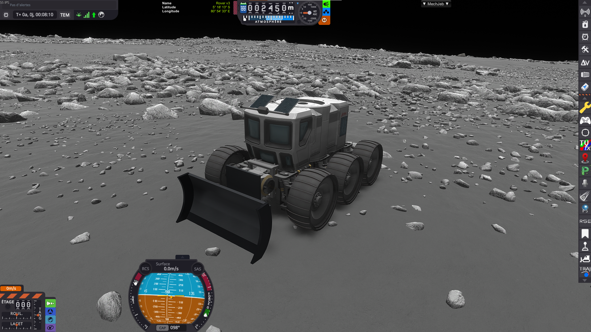
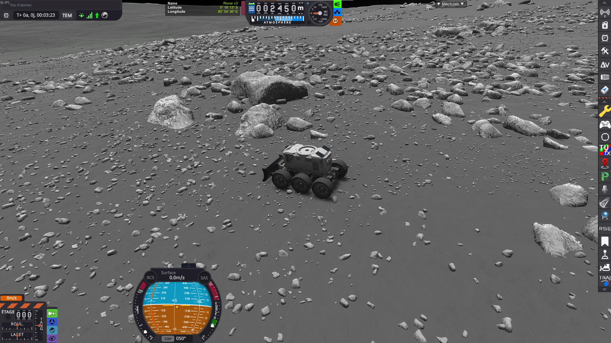
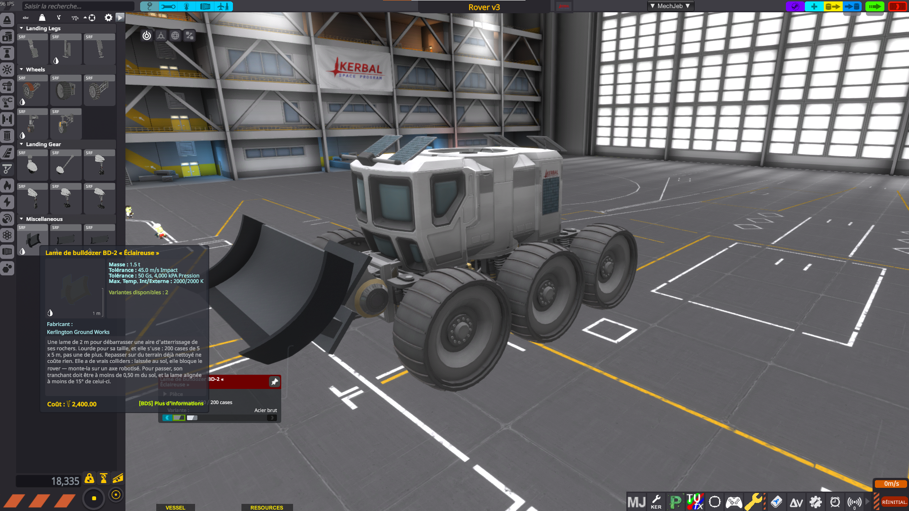
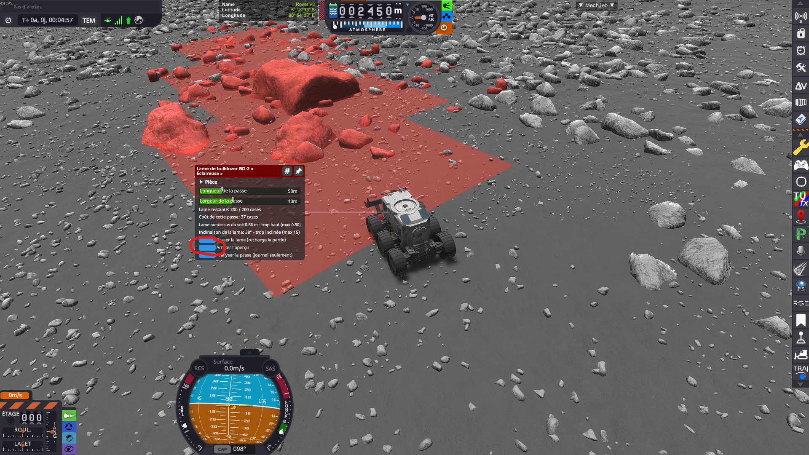
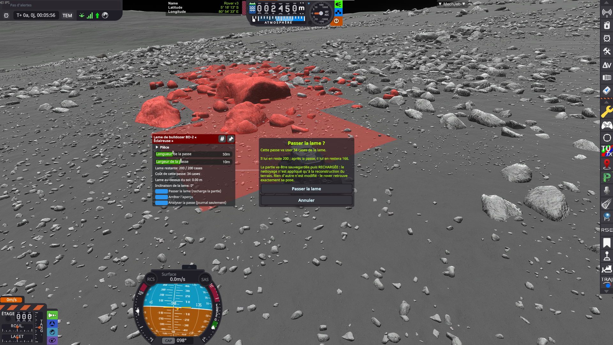
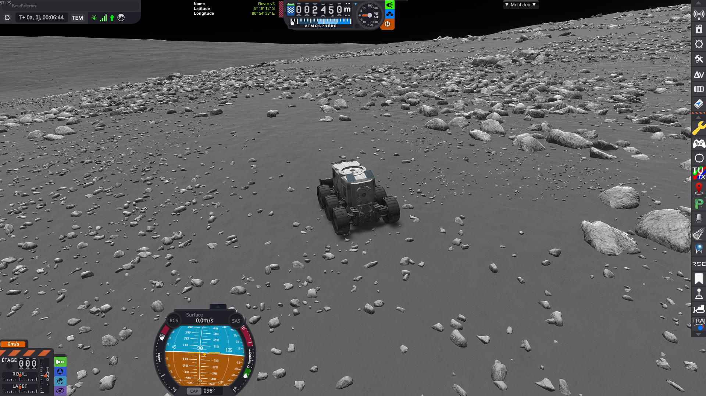
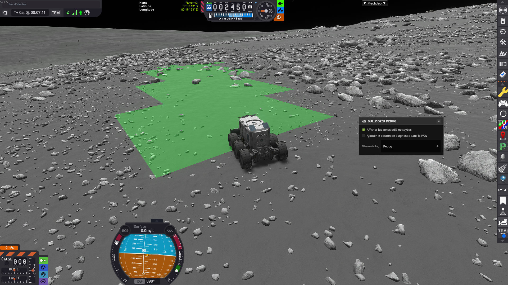
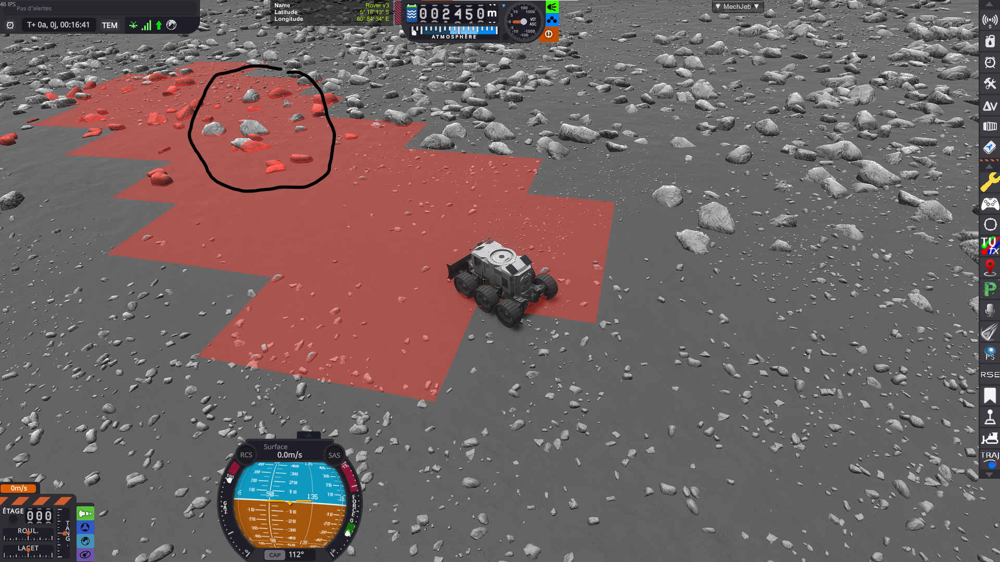

# Bulldozer for Parallax Scatters

A Kerbal Space Program (1.12) mod that **clears the rocks Parallax scatters over the ground**, on a strip in front of a blade, **permanently**.

It only ever removes scatters: it tells Parallax not to grow its rocks where you have driven the blade. The ground itself is left exactly as it was.



Requires **[Parallax Continued](https://github.com/Gameslinx/Tessellation)**. Without it there is nothing to clear, and KSP will not load the mod at all (it is declared as a hard assembly dependency).

> ### ⚠️ Trying the mod out? Not around the KSC.
>
> **Nothing will be cleared anywhere near the space centre.** Parallax reserves that whole area for its own exclusion decal — several kilometres around the KSC — and a piece of terrain only accepts one. The mod refuses the pass and tells you who owns the ground, but if you were testing there you will conclude it does not work.
>
> **Drive or fly a few kilometres away first**, or test on another body. It works everywhere else.

---

## Why this exists

Parallax's terrain is gorgeous, and the rocks it scatters on it are a large part of why. They are also, once you actually want to *do* something on the ground, in the way.



There is no vanilla way to get rid of them, and the usual workarounds all cost something you would rather keep: turning the scatters off spoils every other landscape in the save, and looking for a clearer patch of ground usually means giving up the site you picked. This mod removes them **where you decide, and only there** — a landing pad, a strip you want to drive along, the footprint of whatever you intend to assemble, EVA-built base included.

---

## Installation

1. Install [Parallax Continued](https://github.com/Gameslinx/Tessellation) and its dependencies.
2. Download `KSPModBulldozer.zip` from the [latest release](https://github.com/lhervier/KSP-Mod-Bulldozer/releases/latest) (or build it, see below).
3. Extract it into your KSP `GameData` folder — you should end up with `<KSP>/GameData/KSPModBulldozer/`.

To uninstall, remove that folder. Zones already cleared in a save simply stop being applied.

---

## How to use it

> The mod is **fully translated into English** (and French). The screenshots below happen to come from a French game — everything they show reads in English in an English install.

### 1. Mount a blade

The three blades live in the editor's **Ground** category, under *Miscellaneous*:



The blades have **real colliders**. Left down, a blade digs into the ground and pins the rover in place — that is on purpose. Carry it on a **robotic hinge**, raise it to drive, lower it to work.

Two ways to attach it:

- **surface attach**, for dropping it straight onto the rover's hull;
- the **stack node on the back plate**, 0.75 / 0.98 / 1.45 m above the cutting edge depending on the model. That height is what lets a hinge keep its arm *level* and still put the cutting edge on the ground.

### 2. Put the blade in a working position

A pass is only allowed if the blade is where it would have to be to push anything: **close to the ground**, and **sitting flat on it**.

| Rule | Threshold |
|---|---|
| **Blade over ground** | at most **0.50 m** between the cutting edge and the ground |
| **Blade tilt** | at most **15°** off the ground — on a slope, a blade that follows the slope is fine |

Both are shown live in the part action window, so you can watch them while you drive the hinge; out of range, the pass is refused with the figures.

### 3. Set the pass, and preview it

In the blade's PAW: **pass length** (5 to 200 m) and **pass width** (5 to 20 m), both in steps of 5 m. The strip starts at the **cutting edge** and runs in the direction the **blade** faces. Two blades on the same chassis therefore make two different passes, each with its own settings.

**Preview the pass** paints the strip on the ground in red, and highlights the rocks that would actually disappear:



> In this shot the blade is still raised: the PAW reads `0.86 m — too high (max 0.50)` and `38° — too steep (max 15)`. The preview works anyway, so you can aim before lowering the blade, but the pass would be refused.

The preview is **exact**: it is not an approximation of the rectangle but the result of the pass itself, computed in advance. What you see is what you get, down to the ragged edges of the strip.

**Only one blade can preview at a time** (it is expensive): turning it on for one blade turns it off on the others.

### 4. Confirm



The dialog states the two things a pass spends that the button itself cannot show: **wear on the blade** and **a reload of the game**.

### 5. The game saves, reloads, and the ground is clear



The reload is not a limitation that could be engineered away: Parallax decides which rocks exist **when it builds a terrain tile**, so the exclusion has to be injected *cold*, before the terrain is built. It is harmless here — only the scatters change, so the rover comes back exactly at its saved pose.

### 6. Check what you have already cleared

A debug window (toolbar button, in flight) can paint every zone already cleared, in green:



It reads the **live masks**, not the recorded passes: a pass that failed to apply, or a tile owned by another mod, shows up as a *hole in the green*. The same window carries a log-level selector and a toggle for the per-pass diagnostic dump.

---

## Reading the preview: rocks are **clusters**, not pebbles

This is the most surprising thing about the mod, and the preview screenshot above shows both halves of it.

Parallax's big scatter families (`LargeRocks`, `HugeRocks`… on the Mun) use **cluster models**: **one instance is a whole group of blocks spread over 15 to 25 m**, anchored at a single point. The mask decides per instance, using **that anchor** — never the blocks themselves.

Two consequences, both visible on the screenshot:

- **Some rocks sitting on the red strip stay grey.** They are neither a bug nor an oversight: their **anchor lies outside the strip**, so they survive even though part of their geometry overhangs it. Move the pass, or widen it, and they get caught.
- **The highlighted boulder sticks far outside the strip.** The same mechanism the other way round: its anchor *is* inside, so the whole cluster goes — taking with it blocks that were metres away from the blade.

The first case is easiest to see on a wide pass, where rocks sit well inside the red and are still not selected:



Every grey rock in there belongs to a cluster anchored *outside* the strip. It is worth taking seriously before paying for a pass: a rock the preview leaves grey is a rock that will still be there afterwards, however deep inside the cleared area it looks.

The practical rule:

> **cleared area ≈ the strip, plus or minus the extent of the clusters**

Measured on the Mun: at a 20 m radius a block still survived 5 m from the rover; at 40 m and at 60 m the ground was clean. A narrow pass clears the gravel and leaves the boulders standing — a legitimate trade-off rather than an error, and **the preview is what shows it to you before you pay**.

One thing works in your favour: **some families are not collidable** (`TinyRocks` and `SmallRocks` on the Mun, grass on Kerbin). They *are* removed, but the game does not describe them instance by instance, so the preview cannot highlight them. The result is always at least as clean as the preview promised, usually cleaner.

---

## Wear: a blade is measured in **cells**

The exclusion mask has a resolution, and the mod exposes it rather than hiding it: **one cell is a 5 × 5 m square of ground**. That is why both sliders move in steps of 5 m — the narrowest possible pass is exactly one cell wide.

A pass costs **the cells it turns from clear to cleared**, each charged to the single terrain tile that owns it. Three consequences, all intentional:

- **going over ground you have already cleared is free** — a second pass on the same spot costs nothing;
- **a pass laid alongside an existing one only pays for what it adds**;
- **clearing ground that has no rocks on it costs full price** — what you spend is the mask, not the rocks.

A compact area of *S* cells on a side therefore costs roughly `S² + 2S` (the area, plus its outline paid once). In practice:

| Blade | Cells | Roughly |
|---|---|---|
| BD-2 | 200 | a **65 × 65 m** pad |
| BD-3 | 600 | a **115 × 115 m** site |
| BD-5 | 2000 | a **215 × 215 m** complex |

An isolated 200 × 5 m pass costs 85 to 100 cells, not 40 — you pay for its outline too. Adjacent passes are much cheaper than scattered ones.

Wear is a **property of the part**, persisted with it: it is not a per-save budget, it is not shared between two blades on the same rover, and **it cannot be refilled**. Two BD-2s give you 400 cells for 3 t; a single BD-3 gives 600 for 3.5 t. Upgrading always beats stacking.

The PAW shows the remaining wear and the cost of the currently configured pass, refreshed live. A pass costing more than what is left is refused **with the figures**, and without a reload. So is a pass that would blacken no new cell at all.

---

## The three blades

| | **BD-2 “Scout”** | **BD-3 “Worksite”** | **BD-5 “Groundbreaker”** |
|---|---|---|---|
| Blade width | 2 m | 3 m | 5 m |
| Mass | 1.5 t | 3.5 t | 8.0 t |
| Cost / entry cost | 2 400 / 8 000 | 6 000 / 20 000 | 15 000 / 45 000 |
| Tech node | `specializedConstruction` | `advMetalworks` | `metaMaterials` |
| **Cells** | **200** | **600** | **2 000** |
| kg per cell | 7.5 | 5.8 | 4.0 |

**The width of the model does not cap the width of the pass.** All three keep the full 5 → 20 m slider — a bulldozer makes several runs, and a 2 m blade clearing a 20 m strip is not cheating. What separates the three models is **how much** they can clear, not how much at once.

The cost per cell *drops* with size, so climbing the tech tree is rewarded; the mass is what stops the answer being "bring ten small ones", since every extra blade has to be landed on the body.

### Two liveries

Each blade ships with two paint jobs, picked from the colour swatches in the part's action window in the editor (the row of chips on the [editor screenshot](#1-mount-a-blade)) — **one entry in the part list**, one model, no extra part:

| | **Raw steel** (default) | **Polished stainless** |
|---|---|---|
| Body | `#858a8f`, matte | `#dbe0e6`, brighter and glossier |
| Cutting lip | `#33363b` | `#7a8087` |
| Stock theme | `Gray` | `Silver` |

Paint only: same mass, same cost, same geometry, same wear quota. Because they reuse stock variant themes, the blades follow along when you switch the whole vessel's theme in the editor.

---

## Performance: why the blades wear out at all

**The wear quota is a performance guard rail dressed up as gameplay**, and it is worth knowing what it protects.

Every terrain tile you have cleared carries, *for the whole session*, a PQS mod and a readable exclusion texture — about **52 KB per tile on the Mun**, **117 KB on Kerbin**. One pass typically touches 4 tiles. All of them are **rebuilt from scratch at every scene load**, and all of them are walked every time the game builds a terrain tile.

So: clearing a base site is cheap, and you will never notice it. **Paving a road across the Mun is not.** That is hundreds of tiles, hundreds of textures rebuilt on every load, and a growing cost on every terrain build for the rest of the session.

Hence the design: blades that are **heavy**, **not refillable**, and **capped in cells**. The player reads "my blade is worn out", which is a comprehensible statement, instead of "the mod is bogging down", which is not. The BD-5's own description says it plainly: *no, it will not pave you a road across the Mun.*

---

## Limits worth knowing

- **Nothing is cleared near the KSC** (see the warning at the top): Parallax's own decal reaches about 5.6 km around it, and a piece of terrain only accepts one. Another mod reserving ground the same way would behave the same, and the refusal always names the owner.
- **Only Parallax scatters are removed.** Stock `PQSLandControl` scatters are untouched (Parallax replaces them anyway), and **Breaking Ground surface features are deliberately left alone** — they are science objects, not decoration, even if they can get in a crane's way.
- **The strip's edge is quantised to 5 m**, and the grids of two neighbouring terrain tiles are not aligned, so a zone straddling a seam can step by up to one cell. Since the visible boundary is made of the surviving rocks, which are irregular anyway, it reads as a natural clearing.
- **A pass is refused if the blade faces more vertically than horizontally** — the horizontal projection of a near-vertical axis is not a heading, just whichever way the deck happens to lean.
- **Changing the terrain detail preset** changes the size of the terrain tiles. Passes recorded under a different preset are skipped with a warning rather than applied in the wrong place.

---

## Building from source

The shared code lives in the [KSP-Shared](https://github.com/lhervier/KSP-Shared) repository, as a git submodule compiled directly into the mod's DLL:

```bash
git clone --recurse-submodules https://github.com/lhervier/KSP-Mod-Bulldozer.git
# or, on an existing clone:
git submodule update --init
```

Then run `build.bat` (or `build.sh`) with the `KSPDIR` environment variable pointing at your KSP install. It produces `Release/KSPModBulldozer.zip`; `install.bat` deploys it into `GameData` (close KSP first).

The blade models are **build products**: `GameData/KSPModBulldozer/Parts/*.mu` is generated by `tools/make_blades.py` (Blender 3.6 + `io_object_mu`), which derives all three blades from their width alone and prints the `.cfg` lines that go with them. Never edit a `.mu` by hand — re-run the generator. `tools/render_blades.py` renders the result for review.

## Documentation

**[CLAUDE.md](CLAUDE.md) is the project document** (written in French): the need it answers, how the Parallax exclusion mechanism works, the geometry of the mask, everything that has been verified in game, and the traps that cost real time along the way. This README is the user-facing summary; that file is the one to read before touching the code.
